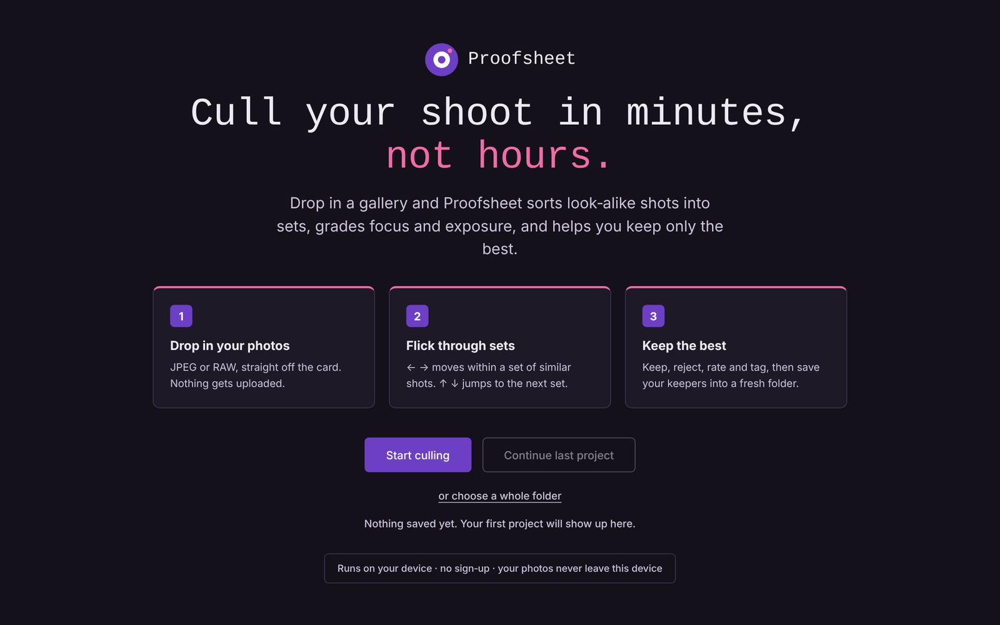
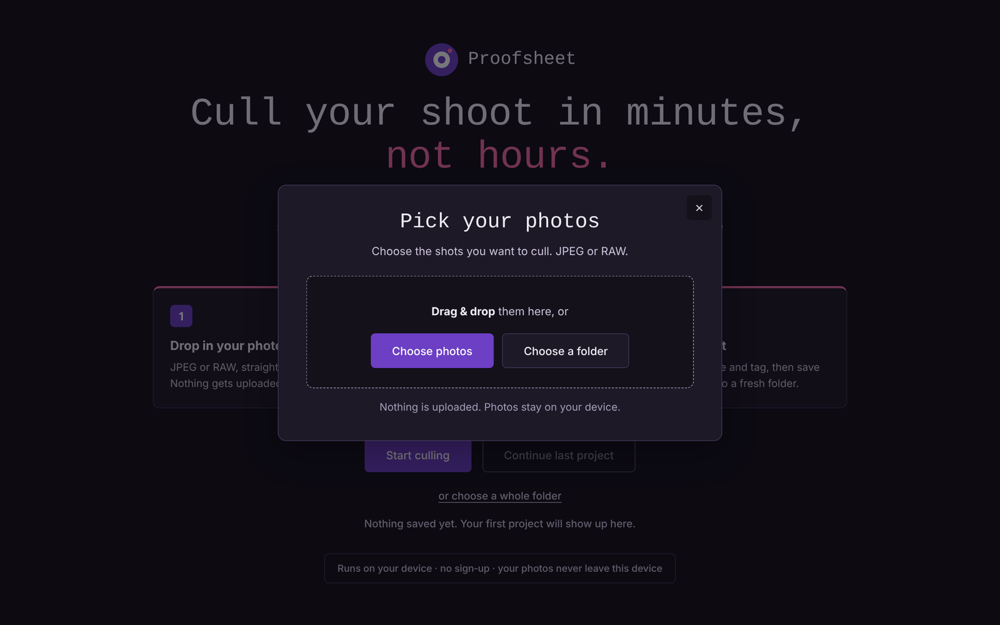
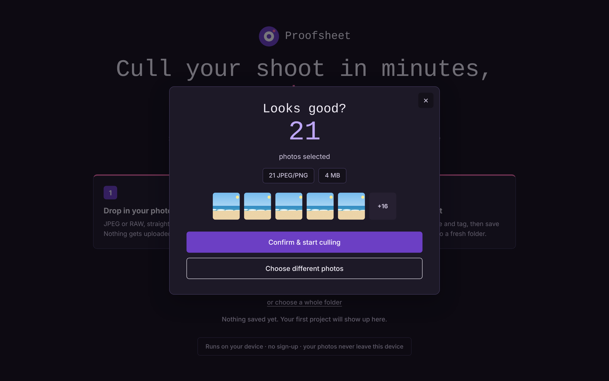
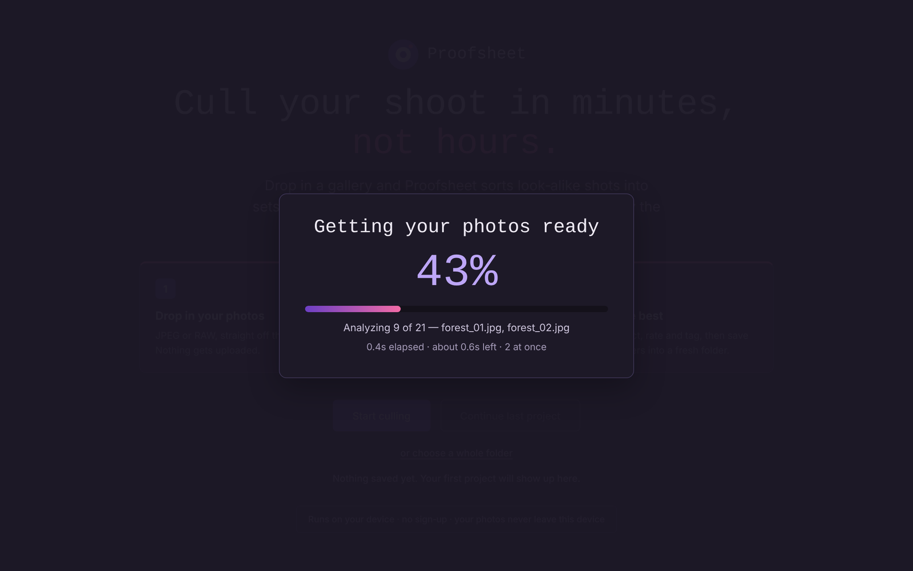
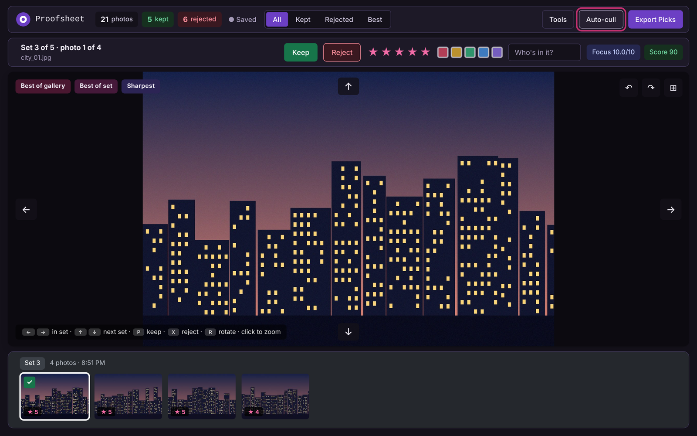
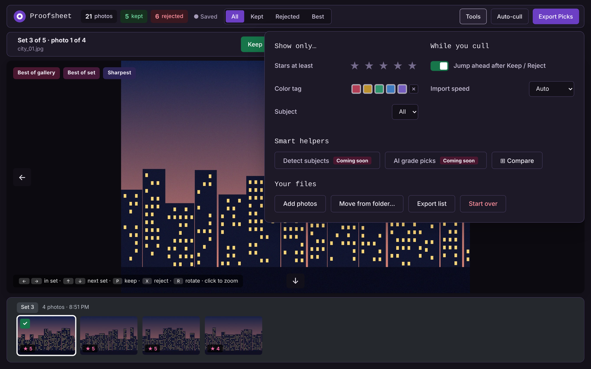
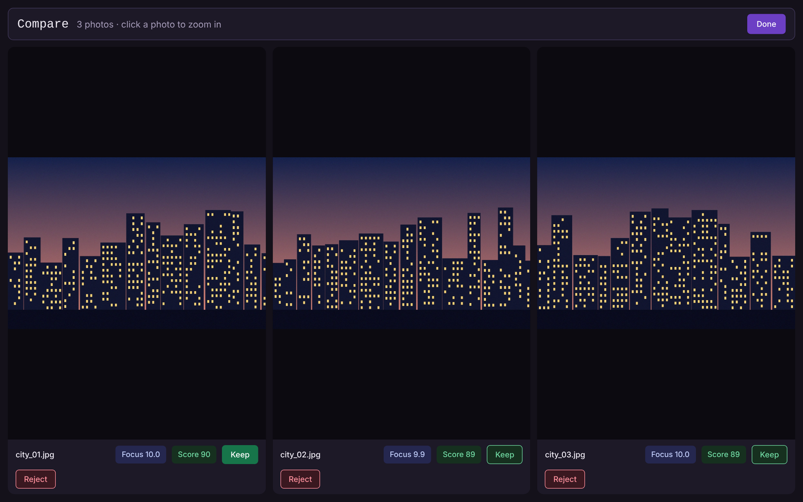
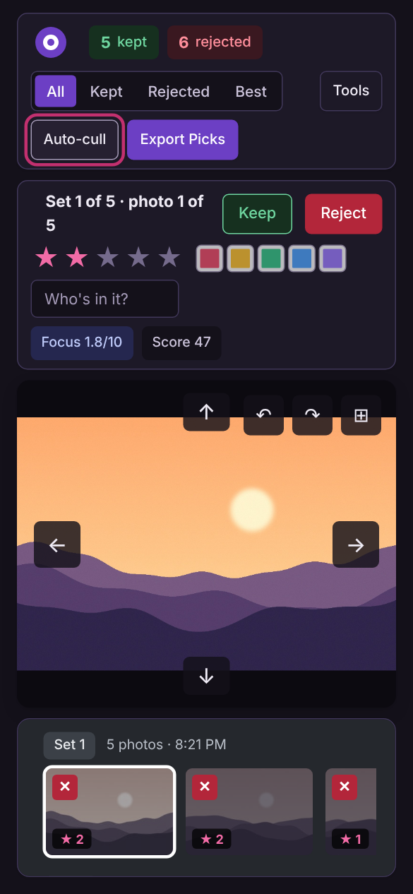

# Proofsheet

A free, no-sign-up photo-culling tool that runs entirely in your browser. Drop in a shoot (JPEG or RAW) and Proofsheet groups look-alike frames into sets, grades focus and exposure, and helps you keep the best and reject the rest.

It is a small static site (one page, one stylesheet, one script) with no server, no account and no install. Your photos never leave your device.

> **Production edition.** This repo contains the same app with all comments removed. It behaves identically to the annotated edition.

## Screenshots

| Intro | Pick your photos |
| --- | --- |
|  |  |

| Review your selection | Importing |
| --- | --- |
|  |  |

**The culling arena.** The selected photo sits in the display box, with every set of similar shots in the strip below.



| Tools and filters | Compare |
| --- | --- |
|  |  |

**On a phone**



> The screenshots use generated demo images, not real photographs.

## Features

- **Smart sets.** Similar frames are grouped using capture time plus image fingerprints.
- **Grading.** Every photo gets a focus score out of 10 and an overall score. Badges mark the best of each set, the sharpest photo, and the best of the gallery.
- **Culling arena.** One large display box, with an endless scrolling strip of sets below it.
- **Keep / Reject, star ratings (1-5) and five color tags.**
- **Rotate while you cull.** Turn the current photo left or right with the buttons on the display box (or `R` / `Shift+R`). The strip thumbnail and the Compare view turn with it, and your choice is saved with the project.
- **Auto-rotation on import.** RAW files store their orientation in the file itself, not in the embedded preview, so sideways shots are detected and turned upright automatically. Upright versions are also used when matching look-alike frames, so a portrait RAW still groups with its JPEG twin.
- **RAW support.** Reads the full-size JPEG preview embedded in CR2, CR3, NEF, ARW, RAF, ORF, RW2, DNG and other RAW formats.
- **Subject names.** Reads EXIF subject data and lets you name who is in each shot, then filter by person.
- **Auto-cull.** Keeps the top frame of each set and rejects clearly weaker ones, without overriding decisions you already made.
- **Compare.** View two to four photos side by side.
- **Export your picks.** Copy kept photos into a new folder (Chrome and Edge), or download a ZIP anywhere else. A "move from folder" tool matches your kept list against a folder of originals.
- **Sessions.** Your decisions auto-save locally, and "Continue last project" verifies your folder before restoring them.
- **Accessible design.** A restrained dark purple and raspberry palette, checked against WCAG AA contrast.

## Quick start

1. Download this repo, or open the hosted copy. Keep `index.html`, `styles.css` and `app.js` together in one folder.
2. Open it in a browser. Chrome or Edge is recommended.
3. Click **Start culling**, choose your photos or a folder, and confirm.
4. Cull, then click **Export Picks** to write your picks to a new folder.

There is no build step. You can double-click the file, or serve the folder:

```bash
python3 -m http.server 8000
# then open http://localhost:8000
```

> Folder saving uses the File System Access API. It works in Chrome and Edge opened directly (not inside an embedded frame). Other browsers fall back to a ZIP download.

## How it works

### The flow

1. **Intro.** Start a new project or continue the last one.
2. **Pick photos.** A modal for choosing photos or a folder (or drag and drop), then a review step showing the count, JPEG vs RAW split, size and a few thumbnails. You confirm to begin.
3. **Import.** A progress screen with timing. At 100% it shows "Ready to review" for about two seconds, fades out and reveals the arena.
4. **Culling arena.** Where you work.

### Per-photo analysis (all on-device)

| Step | What it does |
| --- | --- |
| Decode | JPEGs are decoded directly. For RAW files, the app scans the bytes for the largest embedded JPEG preview. |
| Downscale | The image is shrunk to 256px by the browser's native decoder (`createImageBitmap`), across a small pool of parallel workers. The Import speed setting controls the pool size. |
| Focus | Laplacian variance measures edge sharpness. Values are log-scaled across the whole gallery to give a focus score from 0 to 10. |
| Exposure | Histogram clipping and midtone balance. |
| Score | About 62% focus and 38% exposure. |
| Fingerprints | 8x8 and 16x16 average hashes, used for similarity matching. |
| Metadata | Capture time (falling back to the file's modified date) and the EXIF subject. |
| Thumbnail | A small JPEG for the strip. |

Focus and score are relative to the shoot: the sharpest frame in a gallery scores 10, and the softest scores 0.

### How sets are formed

Photos are sorted by capture time, then each one is compared with the **running average** of the current set (not just the previous frame), so one transitional shot can't chain two unrelated photos together. A photo can only join the current set if it was taken within **60 seconds** of the previous frame. Then its 8x8 hash distance to the set decides:

| 8x8 distance (of 64 bits) | Result |
| --- | --- |
| 10 or less | Same set |
| 22 or more | New set |
| Between 10 and 22 | Borderline: the finer 16x16 hash decides (same set if the distance is 64 or less, of 256 bits) |

The thresholds are constants (`BATCH_TIME_GAP_S`, `HASH8_THRESHOLD`, `HASH8_MARGIN`, `HASH16_THRESHOLD`) near the batching code and are easy to tune.

### The culling arena

- **Top bar:** counts, filter tabs (All / Kept / Rejected / Best), Tools, Auto-cull and Export Picks.
- **Photo bar** (above the display box): Keep, Reject, stars, color tags, subject name, focus and score.
- **Display box:** the selected photo at about 63% of the screen height, with click-to-zoom and swipe on touch screens.
- **Strip** (below): every set is a row on a dark gray background, and only the photo you are viewing is highlighted.
  - Left and Right move within a set of similar shots.
  - Up and Down jump to the previous or next set.

### Keyboard shortcuts

| Key | Action |
| --- | --- |
| Left / Right | Previous / next photo in the set |
| Up / Down | Previous / next set |
| `P` or `K` | Keep |
| `X` | Reject |
| `0`-`5` | Set stars |
| `6`-`9` | Color tags |
| `C` | Add to compare |
| `Z` | Zoom |
| `R` / `Shift+R` | Rotate right / left |
| `Space` | Advance |
| `Esc` | Close dialogs and popovers |

### Auto-cull

For each set it keeps the highest-scoring frame and rejects any frame more than 22 points behind it or with a focus value under 25 (out of 100). Frames in between are left undecided. Photos you have already kept or rejected are never changed, and unrated photos get suggested stars based on their score.

### Sessions

Your decisions (keep/reject, stars, colors and subject names) are saved to `localStorage` about 1.5 seconds after a change and when the tab closes. The photos themselves are not stored. They are matched by **filename** when you continue, so select the same folder.

- All files found: everything is restored and you land on your first unreviewed photo.
- Some files found: the matching photos open, and the saved choices for the rest are kept.
- None found: you get a wrong-folder warning.

Starting a new project replaces the saved one once you make your first decision in it.

## Privacy

- Photos are processed locally and are never uploaded.
- Your decisions are stored only in your browser's `localStorage`.
- The only outside request is loading the Roboto and Special Elite fonts from Google Fonts. If they can't load, the app falls back to system fonts.

## Deploying

Proofsheet is three static files, so it works on any static host (GitHub Pages, Netlify, Vercel, Cloudflare Pages). There is no backend and no API key.

To publish with GitHub Pages, push this repo, open **Settings, Pages**, choose your branch and the root folder, and save.

## Browser support

| Feature | Chrome / Edge | Safari / Firefox |
| --- | --- | --- |
| Culling, grading, sets, RAW previews | Yes | Yes |
| Export picks to a new folder | Yes | ZIP download instead |
| Move from folder | Yes | Not available |

## Project layout

```text
LICENSE             # MIT license
index.html          # page markup
styles.css          # all styling (colors are CSS custom properties)
app.js              # all behavior: import, grading, sets, culling, export
README.md
docs/screenshots/   # images used in this README
```

Colors are CSS custom properties on `:root`, so the palette is easy to change.

## Roadmap

- Face-based subject detection (coming soon)
- AI grading of composition and expression (coming soon, with your own API key)

## Known limitations

- Focus and exposure are heuristics, so they can't judge artistic merit.
- RAW files use their embedded preview rather than a full RAW render. A few cameras with tiny or missing previews may be skipped.
- Sets are tuned for typical shoots. Near-identical scenes shot more than a minute apart are split.
- Photos are matched by filename. Two files with the same name in different folders can collide when saving or continuing a project.
- "Move from folder" only looks at the top level of the folder you choose.
- Rotation is for viewing only. Your original files are never changed, so exported copies keep the orientation they had. Mirrored orientations (rare) are not auto-corrected.
- ZIP downloads are stored without compression and are limited to about 4 GB.
- Very large imports (thousands of photos) depend on the device's memory.

## License

[MIT](LICENSE). You are free to use, copy, modify and distribute Proofsheet, including commercially, as long as the copyright and license notice are kept.
